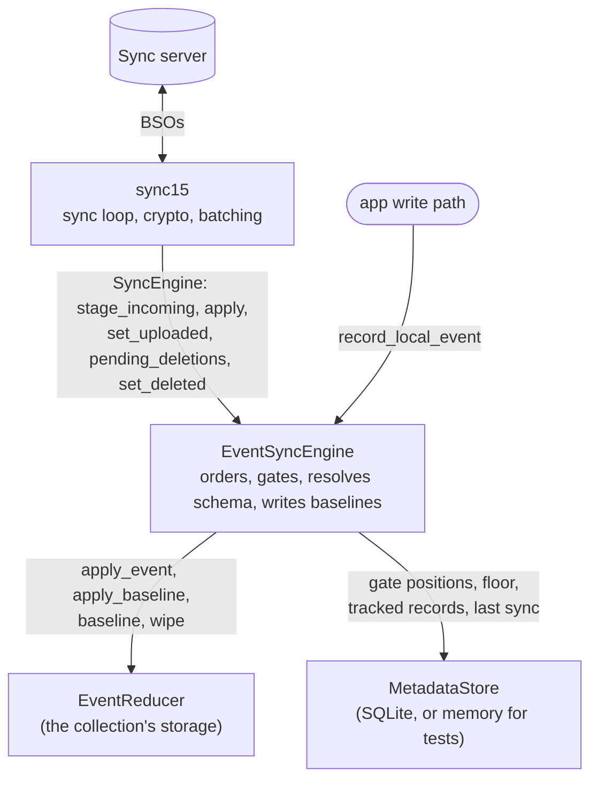
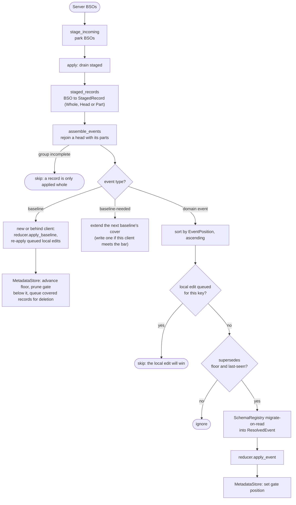
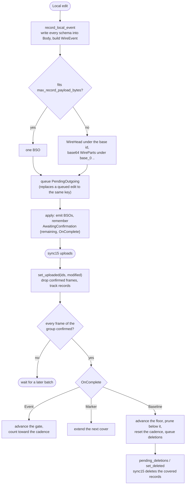

# event_based_sync_engine

A generic, storage-agnostic, event-based sync engine built on `sync15`. A
collection records each local change as a small *event*. The engine
uploads it, downloads everyone else's, puts them all in order and hands
the winners to the collection's *reducer*, which folds them into local
storage. The engine never reads a payload: it orders, gates, resolves the
schema, and dispatches.

## Concepts

- **Event**: the unit the engine orders and applies. It has a caller-defined
  type (`created`, `modify-name`, `deleted`), the *entity* it is about (a GUID),
  and a payload the engine never inspects. When an event is uploaded, the server
  stamps it with a `modified` timestamp. That timestamp is the event's
  `EventPosition`, the order every client agrees on. Two events with the same
  timestamp are ordered by record id.
- **Gate**: conflicts are resolved per `(event type, entity)`, the `GateKey`.
  For each key the engine remembers the newest position it has applied, and an
  incoming event is applied only if it is strictly newer. Renaming X and
  changing X's color never conflict, and two renames of X resolve to the later
  one on every client.
- **Reducer**: the caller's storage, behind the `EventReducer` trait. It applies
  a winning event, dumps its full state for a baseline, and rebuilds from one. It
  must be deterministic, so that folding the same events yields the same state
  everywhere.
- **Schema**: payloads carry a caller-defined schema version. A `Body` holds the
  payload in every version from the client's current schema down to a floor, so
  an older client can read its own version. A client that receives a body with
  only older versions migrates it up in memory, using the  migrations registered
  in its `SchemaRegistry`.
- **Baseline**: an event stream grows forever, so every so many events a client
  writes a *baseline*: the reducer's full state, tagged with the position it
  covers. A new client starts from the newest readable baseline instead of
  replaying history. So does a client that fell behind one, because the events
  it missed may already be gone. Every other client treats the covered position
  as a *floor* and ignores older events. Once a baseline is durable, the records
  it covers are deleted from the server. Only a client whose schema is at least
  as new as every event since the last baseline may write one. A client below
  that bar asks for one with a `baseline-needed` marker. If nobody capable
  answers within a timeout (thirty days by default), the highest-schema client
  still syncing writes one anyway.
- **Record**: an event's form on the wire. A small event is one `WireEvent` in
  one BSO. An event bigger than `max_record_payload_bytes` is split into a
  `WireHead` carrying its header, under the base record id, and `WirePart`s
  carrying base64 slices of its body, under `{base}_0 ..`. Together these are
  the event's *frames*, and a reader rejoins them before parsing. A baseline or
  a marker is a record with a reserved event type, so it travels the same path.
  On the way in, one or more records become one `IncomingEvent`, which the gate
  resolves to a `ResolvedEvent` for the reducer.

## Components



The caller owns the data and the schema migrations. `sync15` owns transport,
crypto and batching. The engine owns everything in between: ordering, the gate,
schema resolution, baselines and their cleanup. The `MetadataStore` holds only
the engine's bookkeeping, never a payload.

## How to use it

A collection plugs in with four pieces: a reducer over its storage, a schema
registry, a metadata store, and a call to `record_local_event` from its write
path.

### 1. Pick event types

Event types are caller-defined strings. Each `(event type, entity)` pair is its
own gate, so give every field you want merged on its own a separate type:

| Event type | Payload |
| --- | --- |
| `created` | every field of the new entity |
| `modify-name` | `{ "name": … }` |
| `modify-color` | `{ "color": … }` |
| `deleted` | `{}` |

Two devices that rename and recolor the same entity while apart then both keep
their change. Under one shared `modify` type, the later edit would overwrite the
other.

The types `__baseline__` and `__baseline_needed__` (`BASELINE_EVENT_TYPE` and
`BASELINE_NEEDED_EVENT_TYPE`) are reserved for the engine.

### 2. Implement `EventReducer`

```rust
use event_based_sync_engine::{EventReducer, ResolvedEvent};
use serde_json::Value;

impl EventReducer for MyStore {
    // Full state as one value. Must be deterministic.
    fn baseline(&self) -> Value {
        self.dump_sorted()
    }

    // Replace local state with a peer's baseline. Called on a cold start, or
    // when this client fell behind a baseline. The engine then re-applies any
    // queued local edits through `apply_event`.
    fn apply_baseline(&self, payload: Value) {
        self.replace_all(payload);
    }

    // Apply one winning event, already migrated to the current schema.
    fn apply_event(&self, e: ResolvedEvent) {
        match e.event_type.as_str() {
            "created" => self.insert(e.entity, e.payload),
            "deleted" => self.remove(&e.entity),
            // The entity may already be gone: a modify after a delete is a no-op.
            _ => self.merge_if_present(&e.entity, &e.payload),
        }
    }

    // Local-only erase, never synced as deletes.
    fn wipe(&self) {
        self.clear();
    }
}
```

The reducer must be deterministic, so the same events fold to the same state on
every client. It must not call `record_local_event` while applying, or every
incoming event would echo back out as a new one.

### 3. Register schema migrations

Start at the oldest schema still in use (the *floor*) and register one up/down
pair per later version, in order:

```rust
use event_based_sync_engine::SchemaRegistry;
use serde_json::json;

let mut schema = SchemaRegistry::new(1);
// Schema 2 adds `icon`: up gives it a default, down drops it.
schema.register_migration(
    2,
    Box::new(|_event_type, mut v| {
        if let Some(obj) = v.as_object_mut() {
            obj.entry("icon").or_insert(json!("default"));
        }
        v
    }),
    Box::new(|_event_type, mut v| {
        if let Some(obj) = v.as_object_mut() {
            obj.remove("icon");
        }
        v
    }),
);
```

A migration receives the event type and the payload and returns the migrated
payload. Like the reducer, it must be pure and identical on every
client. Versions must be registered in order with no gaps.

### 4. Build the engine

```rust
use event_based_sync_engine::{BaselineConfig, EventSyncEngine, SqliteMetadataStore};

let meta = SqliteMetadataStore::open(&db_path, "containers")?;
let engine = EventSyncEngine::new("containers", Box::new(store), schema, Box::new(meta))
    // Optional. The defaults are a baseline every 500 events and a thirty-day
    // timeout on the schema bar.
    .with_baseline_config(BaselineConfig {
        events_per_baseline: Some(200),
        ..BaselineConfig::default()
    });
```

`SqliteMetadataStore` It keeps every collection in one key/value table,
so a single database file can back several engines.
`MemoryMetadataStore` is for tests.

`with_max_record_payload_bytes` sets the byte budget above which a record is
split, 256 KiB by default. The head is never split, so the budget must leave
room for a header, about 100 bytes.

### 5. Record local edits

Call it from the write path, after the local change has been committed, with
the payload in the client's current schema:

```rust
engine.record_local_event("modify-name", id.clone(), json!({ "name": "Work" }))?;
```

The event goes up on the next sync. Two edits to the same field between syncs
collapse into the last one, since only the newest could win anyway. If an upload
fails, the event is resent on the next sync. Queued events live only in memory,
though, so an edit made just before a restart is lost. A consumer-owned outbox
is the planned fix.

## Event lifecycle

### Incoming: server to reducer



1. [`stage_incoming`](src/engine.rs#L545) parks the downloaded `IncomingBso`s.
2. [`apply`](src/engine.rs#L554) drains them:
   - [`staged_records`](src/engine.rs#L390) parses each BSO into a
     [`StagedRecord`](src/engine.rs#L116): a whole record, the head of a split
     one, or one of its body parts.
   - [`assemble_events`](src/engine.rs#L442) rejoins each head with its parts
     and sorts every complete record into an
     [`IncomingEvent`](src/event.rs#L118), a baseline, or a `baseline-needed`
     marker. A group still missing a frame is skipped. A record is only ever
     applied whole.
   - A baseline: a new client, or one whose last sync is older than the
     baseline's cover, rebuilds from it through
     [`apply_baseline`](src/reducer.rs#L45) and then re-applies its own queued
     local edits ([`replay_outgoing`](src/engine.rs#L361)). Every client
     advances its floor to the cover, prunes the gate below it, and queues the
     records the baseline covers for deletion from the server.
   - A `baseline-needed` marker: the next baseline's cover is extended to
     include it, so the marker is deleted along with the events it asked about.
     If this client meets the schema bar, it writes that baseline now.
   - Domain events are sorted by [`EventPosition`](src/event.rs#L59) and gated
     per [`GateKey`](src/event.rs#L35). An event for a key with a local edit
     still waiting to upload is skipped, because that edit will land with a
     newer timestamp and win. Any other event goes through
     [`ingest`](src/engine.rs#L296), which applies it only if it
     [`supersedes`](src/event.rs#L93) both the floor and the last-seen position
     for its key.
   - A winner is migrated on read to the current schema by
     [`SchemaRegistry::read`](src/schema.rs#L193) and handed to the reducer as a
     [`ResolvedEvent`](src/reducer.rs#L17). Its position becomes the key's new
     last-seen.

### Outgoing: local edit to server



1. [`record_local_event`](src/engine.rs#L189) writes the payload in every
   schema, serializes a [`WireEvent`](src/event.rs#L175), turns it into one or
   more `OutgoingBso`s under a fresh random id ([`frame`](src/engine.rs#L258)),
   and queues it as a [`PendingOutgoing`](src/engine.rs#L63). A queued edit to
   the same key is replaced.
2. [`apply`](src/engine.rs#L554) emits the queued BSOs and remembers each record
   as an [`AwaitingConfirmation`](src/engine.rs#L76), keyed by its base id,
   together with the [`OnComplete`](src/engine.rs#L98) side effect to run once
   the upload is confirmed. The baselines and markers the cadence emits go
   through the same bookkeeping, since on the wire they are just events.
3. [`set_uploaded`](src/engine.rs#L762) confirms each frame and tracks the
   record under its event's position, so a later baseline knows what to delete.
   Once every frame of a record has landed, its `OnComplete` runs. An event
   advances its gate position and counts toward the cadence. A marker extends
   the next cover. A baseline advances the floor, prunes the gate below it, and
   queues the records it covers for deletion. Neither the gate nor the floor
   ever moves on a half-uploaded record.
4. After the upload, `sync15` asks the engine for
   [`pending_deletions`](src/engine.rs#L845), sends the DELETE, and reports back
   through [`set_deleted`](src/engine.rs#L852). The cover is persisted, so a
   failed delete is retried on the next sync.

The server assigns the authoritative `modified`, so a position is final only
after `set_uploaded`. Anything still awaiting confirmation when the next `apply`
starts came from an upload that failed.
[`requeue_unconfirmed`](src/engine.rs#L231) puts it back in the queue, unless
the download shows it landed after all, or a newer edit to the same key has been
queued since.
