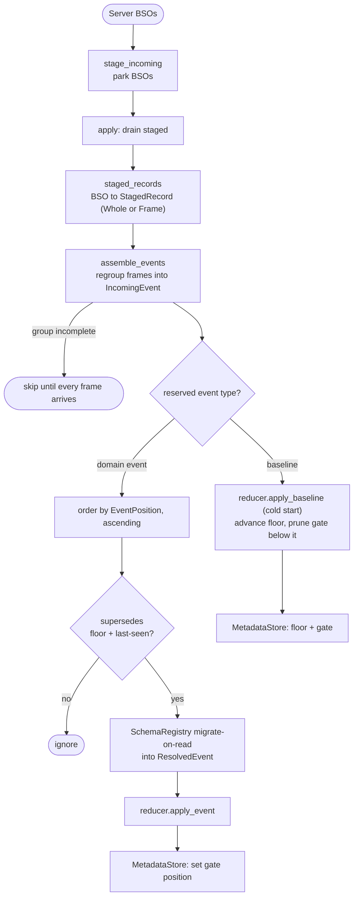
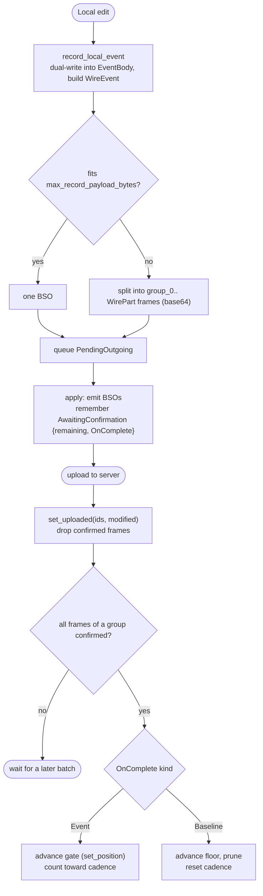

# event_based_sync_engine

A generic, storage-agnostic, event-based sync engine. It transports opaque,
GUID-keyed *events* over `sync15` and folds them into the caller's storage through
a reducer, instead of dumping and reconciling a whole data structure.

The engine never interprets a payload: it orders, gates, resolves schema, and
dispatches. All domain logic lives in the caller's `EventReducer`.

An *event* is the logical unit the engine orders and applies: an `IncomingEvent`,
resolved to a `ResolvedEvent` for the reducer.
A *record* is its form on the wire: a `WireEvent` serialized into one BSO, or, when
it is bigger than `max_record_payload_bytes`, several `WirePart` frames sharing a
group id (each parsed into a `StagedRecord` on the way in).
So one `WireEvent` maps to on or more records, which `assemble_events` reassembles
back into an `IncomingEvent` before applying.

## Event lifecycle

### Incoming: server to reducer

1. `stage_incoming` parks the downloaded `IncomingBso`s.
2. `apply` drains them:
   - `staged_records` parses each `IncomingBso` into a `StagedRecord` (a
     `RawRecord::Whole`, or one `RawRecord::Frame` of a split one).
   - `assemble_events` reassembles frames by group into whole `IncomingEvent`s. An
     incomplete group is skipped until every frame is present.
   - each `IncomingEvent` is ordered by its `EventPosition` and gated per `GateKey`:
     it applies only if it `supersedes` the last-seen `EventPosition` for its key
     (and the floor).
   - `SchemaRegistry` migrates a winner on read to the current schema, then it is
     dispatched to the `EventReducer` as a `ResolvedEvent`.
   - a baseline `WireEvent` instead advances the *floor* in the `MetadataStore` and
     prunes the gate below it.

### Outgoing: local edit to server

1. `record_local_event` serializes the change into a `WireEvent`, frames it into
   `OutgoingBso`s, and queues it as a `PendingOutgoing`.
2. `apply` emits the queued `OutgoingBso`s and remembers each as an
   `AwaitingConfirmation` (keyed by group id), tagged with the `OnComplete`
   side-effect to run once its upload is confirmed.
3. `set_uploaded` confirms each frame. Once every frame of a record lands, its
   `OnComplete` runs: `OnComplete::Event` advances the event's `GateKey` position,
   `OnComplete::Baseline` advances the floor. The gate and floor never move on a
   half-uploaded record.

The server assigns the authoritative `modified` timestamp, so a position is final
only after `set_uploaded`.